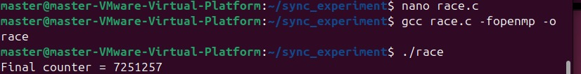
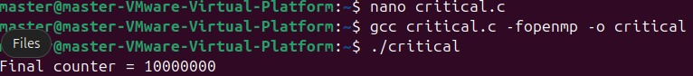
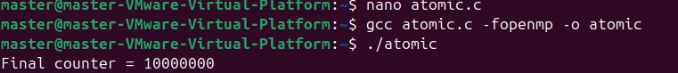
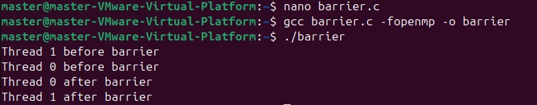
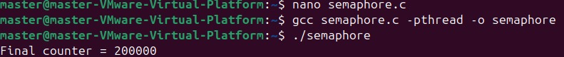
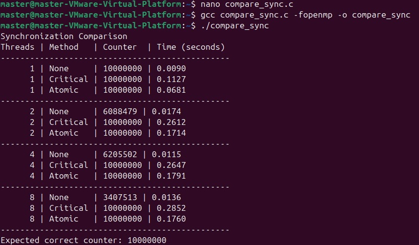

# Synchronization Mechanisms in Parallel Programs
### PGC Experiment 5: Shared-Memory Concurrency, Mutual Exclusion, and Performance Scalability


A comprehensive, reproducible parallel computing laboratory project analyzing shared-memory race conditions, critical sections, atomic updates, barrier coordination, and POSIX semaphores using GCC, OpenMP, and pthreads on Ubuntu 22.04 LTS.

---

## 1. Project Overview

In shared-memory parallel programming, multiple threads concurrently access and mutate shared state. Without explicit synchronization, operations interleave non-deterministically at the machine-instruction level, causing severe data loss known as **race conditions**. 

While synchronization constructs guarantee data integrity, they introduce performance trade-offs, lock contention, and hardware cache invalidation overhead. This repository implements, inspects, and benchmarks the fundamental synchronization primitives in C across varying thread counts ($1, 2, 4, \text{and } 8 \text{ threads}$) on an Ubuntu 22.04 LTS virtualized environment.

---

## 2. Objectives

- **Expose Race Conditions**: Demonstrate non-deterministic data corruption when concurrent OpenMP threads update a shared variable without coordination.
- **Implement Mutual Exclusion**: Safeguard critical sections using `#pragma omp critical` and examine lock contention behavior.
- **Evaluate Hardware-Level Atomics**: Implement lightweight synchronization using `#pragma omp atomic` and compare latency against coarse-grained locking.
- **Coordinate Parallel Phases**: Apply `#pragma omp barrier` to enforce global thread synchronization barriers between distinct execution phases.
- **Implement POSIX Semaphores**: Protect shared state in native POSIX threads (`pthreads`) using unnamed binary semaphores (`sem_t`).
- **Benchmark Scalability & Overhead**: Measure execution time, correctness, and throughput across $1, 2, 4, \text{and } 8 \text{ threads}$ for 10,000,000 shared increments.

---

## 3. Core Concepts Covered

1. **Data Race / Race Condition**: Concurrent execution of read-modify-write sequences (`counter++`) where interleaving leads to silent data loss.
2. **Mutual Exclusion (Mutex)**: Guaranteeing that only a single thread executes a sensitive block of instructions at any given instant.
3. **Atomic Operations**: Hardware-enforced, indivisible memory operations (e.g., `LOCK XADD` on x86) bypassing software lock queues.
4. **Phase Synchronization (Barrier)**: A collective rendezvous point where threads pause until all members of the team have arrived.
5. **Counting vs. Binary Semaphores**: Integer-based signaling objects controlling concurrent access to resources.
6. **Amdahl's Law & Synchronization Inversion**: Why parallelizing a 100% synchronized loop degrades execution time as thread count increases.
7. **Cache Coherence & False Sharing**: Bus contention and cache-line invalidation traffic across CPU core caches during concurrent writes.

---

## 4. Technologies & Software Requirements

- **Operating System**: Ubuntu 22.04 LTS (x86_64) running inside VMware Workstation Pro / Player
- **Compiler**: GCC 11.4+ (or compatible MinGW-w64 GCC on Windows)
- **Parallel Frameworks**:
  - **OpenMP** (`libgomp`, bundled with GCC) for directive-based multithreading
  - **POSIX Threads** (`libpthread`) for low-level thread lifecycle management
  - **POSIX Semaphores** (`semaphore.h`) for binary semaphore locking
- **Build System**: GNU Make (`make`)

---

## 5. Repository Structure

```text
pgc_exp3_synchronization_mechanisms/
├── .gitignore                    # Excludes compiled binaries, object files, and editor artifacts
├── LICENSE                       # MIT License
├── Makefile                      # Standard build rules for all targets and clean
├── README.md                     # Comprehensive project documentation and benchmark analysis
├── race.c                        # Program 1: Unsynchronized counter demonstrating race condition
├── critical.c                    # Program 2: Mutual exclusion via #pragma omp critical
├── atomic.c                      # Program 3: Hardware-assisted synchronization via #pragma omp atomic
├── barrier.c                     # Program 4: Phase coordination using #pragma omp barrier
├── semaphore.c                   # Program 5: POSIX threads with binary sem_t semaphore
├── compare_sync.c                # Program 6: Comparative benchmark across 1, 2, 4, 8 threads
├── docs/
│   └── experiment-notes.md       # Laboratory notes, theoretical background, and observations
├── results/
│   ├── benchmark_results.txt     # Raw benchmark logs (historical VM run + local run)
│   └── observations.md           # In-depth architectural analysis of synchronization overhead
└── screenshots/
    ├── race-condition.png        # Terminal execution: race condition failure (7,251,257)
    ├── critical-section.png      # Terminal execution: critical section success (10,000,000)
    ├── atomic-operation.png      # Terminal execution: atomic update success (10,000,000)
    ├── barrier.png               # Terminal execution: phase barrier coordination
    ├── semaphore.png             # Terminal execution: pthread binary semaphore (200,000)
    └── benchmark-comparison.png  # Terminal execution: full benchmark table across 1, 2, 4, 8 threads
```

---

## 6. Installation & Setup Instructions (Ubuntu 22.04 LTS)

### Step 1: Update System Repositories
Open your terminal (`Ctrl + Alt + T`) and update package indices:
```bash
sudo apt update && sudo apt upgrade -y
```

### Step 2: Install Build Essentials (GCC, G++, Make, OpenMP)
Install the C toolchain, standard libraries, and GNU Make:
```bash
sudo apt install build-essential -y
```

### Step 3: Verify Toolchain and OpenMP Support
Confirm compiler installation and verify OpenMP preprocessor availability:
```bash
gcc --version
echo '#include <omp.h>' | gcc -E -fopenmp -xc - > /dev/null && echo "OpenMP is ready!"
```

### Step 4: Clone the Repository
```bash
git clone https://github.com/01fe24bci116/pgc_exp3_synchronization_mechanisms.git
cd pgc_exp3_synchronization_mechanisms
```

---

## 7. Compilation & Execution Commands

### Using the Automated Makefile (Recommended)

| Target | Command | Description |
| :--- | :--- | :--- |
| **All Programs** | `make` or `make all` | Compiles all 6 programs with `-Wall -Wextra` |
| **Race Condition** | `make race` | Builds `./race` |
| **Critical Section** | `make critical` | Builds `./critical` |
| **Atomic Operation** | `make atomic` | Builds `./atomic` |
| **Barrier** | `make barrier` | Builds `./barrier` |
| **Semaphore** | `make semaphore` | Builds `./semaphore` using `-pthread` |
| **Benchmark** | `make compare` | Builds `./compare_sync` |
| **Clean Artifacts** | `make clean` | Removes generated binaries and object files |

### Manual Compilation Commands

```bash
# 1. Unsynchronized Race Condition
gcc race.c -fopenmp -o race
./race

# 2. OpenMP Critical Section
gcc critical.c -fopenmp -o critical
./critical

# 3. OpenMP Atomic Operation
gcc atomic.c -fopenmp -o atomic
./atomic

# 4. OpenMP Barrier Synchronization
gcc barrier.c -fopenmp -o barrier
./barrier

# 5. POSIX Threads and Semaphore
gcc semaphore.c -pthread -o semaphore
./semaphore

# 6. Comparison Benchmark
gcc compare_sync.c -fopenmp -o compare_sync
./compare_sync
```

> **Tip**: You can override the thread count for any OpenMP program using the `OMP_NUM_THREADS` environment variable:
> ```bash
> OMP_NUM_THREADS=4 ./atomic
> ```

---

## 8. Detailed Explanation of Synchronization Mechanisms

### 1. Unsynchronized Shared Increment (`race.c`)
- **Problem**: When multiple threads execute `counter++`, the operation is translated into three assembly instructions:
  1. `READ`: Load `counter` from RAM/cache into a CPU register.
  2. `MODIFY`: Increment the register value.
  3. `WRITE`: Write the register value back to `counter` in memory.
- **Failure Mode**: When two threads execute concurrently without synchronization, both may read the same value (e.g., `42`), increment it locally to `43`, and store `43` back. Two increments occurred, but the counter only advanced by 1. One update was silently lost.
- **Pedagogical Note**: Compiling without aggressive optimization (`-O2`) preserves these distinct memory load/store operations, reliably demonstrating the data race.

### 2. Critical Section (`critical.c`)
- **Directive**: `#pragma omp critical`
- **Behavior**: Enforces mutual exclusion across the enclosed structured block. Only one thread can enter the critical section at any instant. All other threads block in a runtime wait queue.
- **Trade-off**: Guarantees 100% correctness (`Final counter = 10,000,000`). However, it turns a parallel program into a serial bottleneck, causing latency to increase as more threads wait in line.

### 3. Atomic Operations (`atomic.c`)
- **Directive**: `#pragma omp atomic`
- **Behavior**: Instructs the compiler to emit a hardware-level atomic instruction (such as `LOCK ADD` or Compare-And-Swap) targeting a specific memory location.
- **Advantage**: Bypasses software lock queues and operating-system mutex calls. Because the hardware cache coherence protocol handles the serialization at wire speeds, atomics are significantly faster and scale better for scalar increments.

### 4. Barrier Synchronization (`barrier.c`)
- **Directive**: `#pragma omp barrier`
- **Behavior**: Acts as a phase rendezvous point. No thread can proceed past the barrier until all threads in the parallel team have arrived.
- **Important Distinction**: A barrier does *not* protect a shared counter variable from simultaneous writes. Instead, it synchronizes execution phases (e.g., ensuring all threads complete Phase 1 before any thread begins Phase 2).

### 5. Binary Semaphore (`semaphore.c`)
- **Library**: `<semaphore.h>` with POSIX threads (`<pthread.h>`)
- **Primitives**: `sem_init(&semaphore, 0, 1)`, `sem_wait(&semaphore)`, and `sem_post(&semaphore)`.
- **Behavior**: A binary semaphore (initialized to 1) behaves as a mutual exclusion lock. If the count is 0, `sem_wait()` places the thread in a sleeping state until woken by `sem_post()`.
- **Workload**: Two threads perform 100,000 increments each, yielding an exact count of `200,000`.

---

## 9. Synchronization Mechanisms Comparison Matrix

| Mechanism | Implementation | Correctness | Synchronization Level | Relative Overhead | Scalability ($1 \to 8$ Threads) |
| :--- | :--- | :---: | :--- | :--- | :--- |
| **None** | Unsynchronized | **Incorrect** (Data Race) | None | Zero overhead | **Poor** (Data loss worsens with threads) |
| **Critical** | `#pragma omp critical` | **Correct** ($10^7$) | High-level software lock | High (Lock contention & queues) | **Poor** (Serial bottleneck degrades time) |
| **Atomic** | `#pragma omp atomic` | **Correct** ($10^7$) | Hardware CPU instruction | Low (Cache-level locking) | **Good** (Consistently fast execution) |
| **Lock** | `omp_lock_t` | **Correct** ($10^7$) | Runtime API lock | High to Severe | **Moderate to Poor** (Contention overhead) |
| **Barrier** | `#pragma omp barrier` | **N/A** (Phase sync) | Team collective barrier | Waiting overhead | **Moderate** (Limited by slowest thread) |
| **Semaphore** | POSIX `sem_t` | **Correct** ($2 \times 10^5$) | OS-level kernel object | Moderate | **Moderate** (System call context switches) |

---

## 10. Actual Benchmark Results

The benchmark program (`compare_sync.c`) executed **10,000,000 shared increments** per test across thread configurations ($1, 2, 4, \text{and } 8 \text{ threads}$).

### A. Primary Measured Dataset (Ubuntu 22.04 LTS VM)
*Environment: VMware Workstation Pro, Ubuntu 22.04 LTS, GCC, OpenMP runtime (`libgomp`).*

| Thread Count | Mechanism | Final Counter | Correctness Status | Wall-Clock Time (s) |
| :---: | :--- | :---: | :---: | :---: |
| **1 Thread** | None | 10,000,000 | **Correct** | 0.0090 s |
| | Critical | 10,000,000 | **Correct** | 0.1127 s |
| | Atomic | 10,000,000 | **Correct** | 0.0681 s |
| **2 Threads** | None | 6,088,479 | **INCORRECT** | 0.0174 s |
| | Critical | 10,000,000 | **Correct** | 0.2612 s |
| | Atomic | 10,000,000 | **Correct** | 0.1714 s |
| **4 Threads** | None | 6,205,502 | **INCORRECT** | 0.0115 s |
| | Critical | 10,000,000 | **Correct** | 0.2647 s |
| | Atomic | 10,000,000 | **Correct** | 0.1791 s |
| **8 Threads** | None | 3,407,513 | **INCORRECT** | 0.0136 s |
| | Critical | 10,000,000 | **Correct** | 0.2852 s |
| | Atomic | 10,000,000 | **Correct** | 0.1760 s |

### B. Reference Manual Sample Data (Lab Manual PDF Section 9)
*Provided as an illustrative reference in the lab syllabus:*

| Mechanism | 1 Thread (s) | 2 Threads (s) | 4 Threads (s) | 8 Threads (s) | Final Result (8 Threads) |
| :--- | :---: | :---: | :---: | :---: | :---: |
| **None** | 0.0486 s | 0.0249 s | 0.0250 s | 0.0250 s | 4,394,535 (INCORRECT) |
| **Critical** | 0.1571 s | 0.1584 s | 0.1583 s | 0.1579 s | 10,000,000 (Correct) |
| **Atomic** | 0.0567 s | 0.0574 s | 0.0585 s | 0.0565 s | 10,000,000 (Correct) |
| **Lock** | 0.1586 s | 0.1590 s | 0.1615 s | 0.1603 s | 10,000,000 (Correct) |

---

## 11. Discussion of Observed Race Conditions & Synchronization Bottlenecks

1. **Why `None` Degrades Sharply**: At 1 thread, there is no concurrency; hence, the result is 10,000,000. At 2 threads, the collision rate immediately causes ~39% of updates to be lost (`6,088,479`). At 8 threads, collision probability escalates, resulting in `3,407,513`—**over 65% of increments were lost**.
2. **The Cost of Safety (`Critical`)**: While `Critical` guarantees that all 10 million increments are counted, its execution time increases from 0.1127s to 0.2852s on the Ubuntu VM. Because 100% of the work is serialized inside the lock, threads spend more time queued and context-switching than performing productive arithmetic.
3. **Atomic Efficiency**: Atomics achieve the same 100% correctness guarantee as critical sections, but complete in **0.1760s vs. 0.2852s** at 8 threads (a **38% speed advantage**). By leveraging CPU bus-locking primitives directly in hardware, atomics eliminate operating system lock management overhead.
4. **Variability in Execution Timings**: Execution timings depend heavily on hardware specifications, hypervisor core allocation, CPU governor settings, and background host load. Benchmark numbers illustrate relative algorithmic complexity rather than fixed machine constants.

---

## 12. Visual Evidence & Execution Screenshots

The following genuine terminal screenshots were captured directly inside the **Ubuntu 22.04 LTS (VMware)** environment:

### Program 1: Race Condition Output

*Figure 1: Executing `./race` yields `7251257` instead of `10000000`, proving uncoordinated memory writes lose data.*

---

### Program 2: Critical Section Output

*Figure 2: Executing `./critical` guarantees mutual exclusion, reaching the exact `10000000` counter.*

---

### Program 3: Atomic Operation Output

*Figure 3: Executing `./atomic` provides hardware-level atomic safety, correctly reaching `10000000`.*

---

### Program 4: Barrier Synchronization Output

*Figure 4: Executing `./barrier` demonstrates that both threads complete Phase 1 before either enters Phase 2.*

---

### Program 5: POSIX Semaphore Output

*Figure 5: Executing `./semaphore` coordinates two pthreads to safely reach `200000` increments.*

---

### Program 6: Comparative Benchmark Output

*Figure 6: Comprehensive comparison benchmark across 1, 2, 4, and 8 threads for None, Critical, and Atomic.*

---

## 13. Important Observations & Conclusion

- **Unsynchronized shared access is never safe**: Race conditions cause silent, catastrophic data corruption that worsens as thread concurrency scales.
- **No single mechanism is universally optimal**:
  - For simple scalar variables, **atomic operations** (`#pragma omp atomic`) offer the best combination of correctness and performance.
  - For non-trivial code blocks involving multiple variables, invariants, or I/O, **critical sections** (`#pragma omp critical`) or locks are mandatory.
  - For multi-stage parallel pipelines, **barriers** (`#pragma omp barrier`) ensure structural phase consistency across threads.
  - For cross-process or custom thread architectures, **POSIX semaphores** provide fine-grained resource and mutual exclusion control.

---

## 14. Troubleshooting & FAQ

### Issue 1: `fatal error: omp.h: No such file or directory`
- **Cause**: OpenMP development libraries are missing.
- **Fix**: Reinstall the build essentials package:
  ```bash
  sudo apt update && sudo apt install build-essential -y
  ```

### Issue 2: `undefined reference to 'pthread_create'` or `sem_init`
- **Cause**: Missing `-pthread` compilation flag when building `semaphore.c`.
- **Fix**: Compile explicitly with `-pthread`:
  ```bash
  gcc semaphore.c -pthread -o semaphore
  ```

### Issue 3: Race condition does not appear (Counter is exactly 10,000,000)
- **Cause**: GCC optimization (`-O2` or `-O3`) vectorized the loop or hoisted the increment into a CPU register.
- **Fix**: Compile without optimization flags (`gcc race.c -fopenmp -o race`) to force memory read/write cycles on each loop iteration.

### Issue 4: `make: command not found`
- **Cause**: GNU Make is not installed.
- **Fix**: Install make via apt:
  ```bash
  sudo apt install make -y
  ```

---

## 15. Student Reproduction Guide

To reproduce this experiment in your own parallel computing lab session:

1. **Start Ubuntu 22.04 LTS** in VMware or VirtualBox with at least **4 virtual CPU cores allocated**.
2. **Open Terminal** and clone this repository:
   ```bash
   git clone https://github.com/01fe24bci116/pgc_exp3_synchronization_mechanisms.git
   cd pgc_exp3_synchronization_mechanisms
   ```
3. **Build all binaries**:
   ```bash
   make
   ```
4. **Run each program sequentially**:
   ```bash
   ./race
   ./critical
   ./atomic
   ./barrier
   ./semaphore
   ./compare_sync
   ```
5. **Record your measurements** in `results/benchmark_results.txt` and compare how your virtual machine's CPU core allocation influences contention overhead!

---

## License

This project is licensed under the [MIT License](LICENSE).
